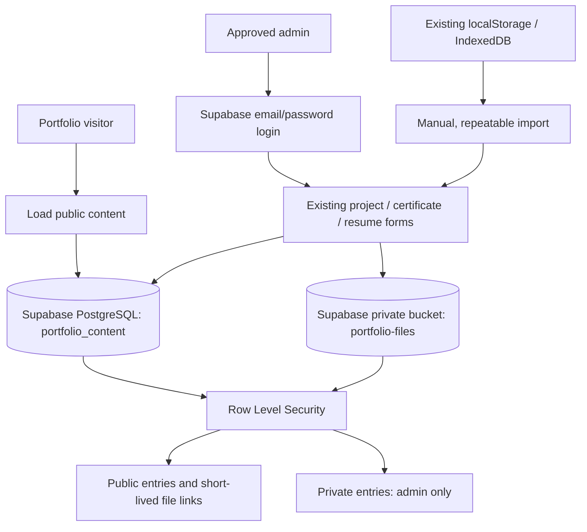

# Shared portfolio storage setup

The integration is implemented, but it will not publish anything until you create and configure your Supabase project. No secret or service-role key is used by this app.

## 1. Create your project

1. Create a project at https://supabase.com/dashboard. Wait for it to finish provisioning.
2. In the SQL Editor, paste and run `supabase/migrations/001_portfolio.sql`. It creates a content table, an admin whitelist, a private file bucket, and database/storage access policies. The migration can be rerun safely.
3. Under Authentication > Users, create your own email/password user and confirm the email. Disable public user sign-ups under Authentication settings; this portfolio has no registration flow.
4. Copy your user's UUID and run this separately in the SQL Editor:

```sql
insert into public.portfolio_admins(user_id)
values ('YOUR-USER-UUID')
on conflict do nothing;
```

Only IDs in this table have write access, even if another user signs in. Do not grant browser users write access to the admin whitelist.

## 2. Configure localhost

Copy `.env.example` to `.env.local`. From Supabase's Connect dialog/project API settings, fill in:

```dotenv
NEXT_PUBLIC_SUPABASE_URL=https://YOUR-PROJECT.supabase.co
NEXT_PUBLIC_SUPABASE_PUBLISHABLE_KEY=YOUR-PUBLISHABLE-KEY
```

Use the publishable key, never a secret or service-role key. The publishable key is intended for the browser; RLS policies enforce access. `.env.local` is ignored by Git.

Install dependencies with `npm install`, restart `npm run dev`, and open http://localhost:3000/admin. Sign in with the user created above. Management pages show the login screen until the approved account signs in. If the variables are missing, they show setup instructions rather than allowing browser-only edits.

## 3. Import your existing content

On `/admin`, choose **Import browser and bundled content**. Use the same localhost browser and origin where your uploads were saved. The import copies bundled projects/certificates and local entries, including images/PDFs and saved resume content, into Supabase. Local visibility settings and deletion markers are preserved.

The import skips IDs already present in Supabase, including deleted entries. It never clears browser data. If it fails partway through, fix the error and retry; completed entries are skipped. Browser storage from another browser, device, or domain cannot be read automatically.

Cloud mode does not merge local data into visitor results. This prevents private overrides of bundled entries from accidentally falling back to public copies. Before the first import, cloud project/certificate lists are empty; the resume uses its bundled default until saved/imported.

## 4. Deploy to Vercel

Add the same two environment variables in the Vercel project's Environment Variables settings for the environments you deploy. Redeploy after setting them, because `NEXT_PUBLIC_` values are included at build time.

Keep the same Supabase project URL locally and on Vercel. The existing desktop/mobile layout is unchanged. Use these admin URLs:

- `/admin`: login, management navigation, and one-time import
- `/project-add`: add/edit/delete projects and remove/replace images
- `/upload-certificates`: add/edit/delete certificates and remove/replace files
- `/resume-update`: edit the resume inside the portfolio desktop

Once configured, public content is shared across devices and visitors without a redeploy. Private content can only be read by an approved admin. Public views explicitly filter private entries even when you are signed in.

## 5. Verify before publishing

Run `npm run test:cloud` for the storage workflow tests and `npx tsc --noEmit` for type checks. These use mocked cloud services; the checks below verify your actual project's policies and uploads.

1. Sign in and add a public project and certificate. Open the portfolio in an incognito window and confirm they appear and the files work.
2. Add private entries. Confirm they are visible in management but absent in incognito, including through direct database requests with the publishable key.
3. Confirm incognito and a signed-in non-admin cannot insert/update/delete rows or upload files. Database/storage policies, not the login screen alone, enforce this.
4. Test replacement, removal, delete, refresh, sign-out, and the resume editor. Cloud changes should survive reload and appear from another device.

The private bucket issues five-minute signed links. Changing visibility blocks new file links immediately; previously issued links can work until they expire. Files originally committed under `public/` remain public static assets; use cloud uploads for confidential documents.

The app refreshes cloud content when a window regains focus and every four minutes; this also renews file links. Reloading immediately fetches current content. Database row saves and file uploads are separate operations: failed row saves attempt to remove new uploads, and successful replacements/deletes attempt to remove old files. If storage cleanup fails, an unreferenced private file may remain for manual removal in Supabase Storage.

## Architecture



References: [Next.js with Supabase](https://supabase.com/docs/guides/getting-started/tutorials/with-nextjs), [Storage access control](https://supabase.com/docs/guides/storage/security/access-control).
